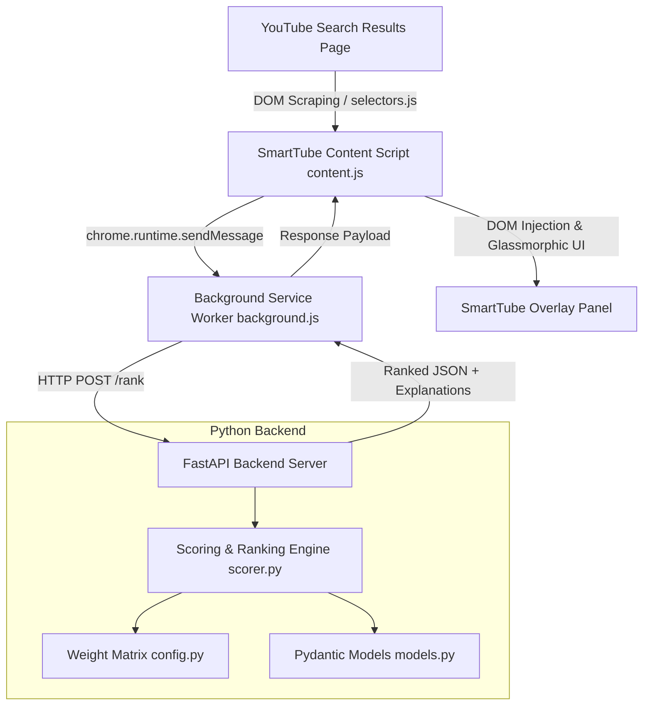

# 🎓 SmartTube — Intelligent YouTube Re-Ranking Browser Extension

> **A portfolio-grade final-year project** that re-ranks YouTube search results by true relevance using a client-side Manifest V3 extension paired with an intelligent Python backend.

---

## 📌 Narrative: Problem to Real-World Impact

1. **The Problem**: YouTube's default algorithm optimizes heavily for watch-time retention, sensationalist clickbait titles, and promotional boost rather than true relevance to an educational or technical search query.
2. **The SmartTube Solution**: Gives power back to the user by extracting visible video metadata directly from the browser DOM, computing a transparent multi-factor relevance score on a Python backend, and presenting a clean, re-ranked overlay with natural language explanations and watch-time savings.
3. **The Roadmap**:
   - **Phase 1 (Current / MVP)**: DOM extraction + weighted baseline scoring matrix + transparent explanation engine + overlay panel.
   - **Phase 2 (NLP Relevance)**: Sentence-transformers semantic embeddings cosine similarity.
   - **Phase 3 (Transcript-Aware)**: Video transcript topic-coverage extraction.
   - **Phase 4 (Personalization)**: SQLite user profile store + feedback learning.
   - **Phase 5 (Save My Time Learning Path)**: Redundancy-free minimal video syllabus builder with natural language intent filtering.

---

## 🏗️ Architecture & Layering



### Layer Breakdown
1. **YouTube Search Page (`youtube.com/results`)**: The client-side entry point.
2. **`selectors.js`**: Dedicated isolation layer mapping YouTube DOM components to Javascript targets.
3. **`content.js`**: Injects the floating *"✨ Analyze Videos"* button, scrapes visible cards, and renders the modal overlay.
4. **`background.js`**: Manifest V3 service worker handling async network dispatch to FastAPI.
5. **FastAPI Backend (`app.py`, `scorer.py`, `config.py`)**: Computes weighted scores across 6 distinct signals:
   - **Relevance to Query**: 35%
   - **Content Quality Signals**: 25%
   - **Engagement & Momentum**: 15%
   - **Freshness**: 10%
   - **Duration Suitability**: 10%
   - **User Preference**: 5%

---

## 📁 Repository Structure

```
smarttube/
├── extension/
│   ├── manifest.json         # Manifest V3 configuration & permissions
│   ├── selectors.js          # Isolated DOM selector configuration
│   ├── content.js            # Injected script: scraper & UI renderer
│   ├── background.js         # Service worker proxying API calls
│   ├── popup.html            # Extension popup settings UI
│   ├── popup.js              # Extension popup controller & health check
│   ├── styles.css            # Modern dark-mode & glassmorphism styling
│   └── icons/                # Extension action & store icons (16, 48, 128)
├── backend/
│   ├── app.py                # FastAPI REST API (/rank and /health)
│   ├── scorer.py             # Weighted multi-factor scoring engine
│   ├── models.py             # Pydantic data models & request/response schemas
│   ├── config.py             # Configurable weight matrix & thresholds
│   └── requirements.txt      # Python dependencies
└── README.md
```

---

## 🚀 Quickstart & Setup Guide

### 1. Backend Setup
Make sure Python 3.9+ is installed.

```bash
# Navigate to the backend directory
cd backend

# Install dependencies
pip install -r requirements.txt

# Start the FastAPI server
uvicorn app:app --reload --port 8000
```

Verify the backend is running by opening: [http://127.0.0.1:8000/docs](http://127.0.0.1:8000/docs) or [http://127.0.0.1:8000/health](http://127.0.0.1:8000/health).

---

### 2. Chrome / Edge Extension Installation

1. Open your Chromium browser (Google Chrome, Microsoft Edge, Brave).
2. Navigate to `chrome://extensions/` (or `edge://extensions/`).
3. Enable **Developer mode** (toggle switch in the top-right corner).
4. Click **Load unpacked**.
5. Select the folder: `smarttube/extension`.
6. Click the extension puzzle icon in your browser toolbar and pin **SmartTube**.
7. Click the SmartTube icon to check the backend connection indicator (it will display **Connected**).

---

### 3. Testing the Flow

1. Go to YouTube and search for any technical or educational topic (e.g. `Python Pandas for data analysis` or `Machine Learning full course`).
2. Notice the floating **✨ Analyze & Re-rank** button in the bottom-right corner.
3. Click **Analyze & Re-rank**.
4. The extension extracts all visible video cards, sends them to the backend, and displays the **SmartTube Relevance Modal**:
   - Ranked order from highest to lowest true relevance score.
   - Tier tags: `🔥 Highly Relevant`, `✅ Relevant`, `📌 Other`.
   - Clear natural-language explanation badges for each ranking decision.
   - "Save My Time" summary bar showing analyzed count, tier breakdowns, and total watch time.
